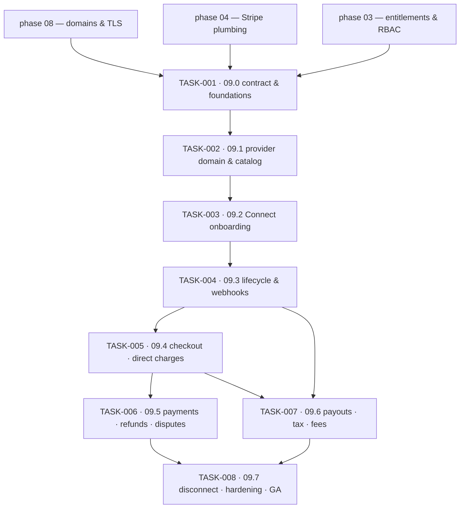

# Phase 09 — Tenant Payment Providers · task order

**Target version:** 0.10.0 · **Theme:** merchant money · **Contexts:** `payments` (new), `tenancy`,
`access`, `platform-admin` (entitlements), `domains`, `localization`, `theming`, `audit`

Eight tasks, one per vertical slice. The *what* and *why* live in
[`../../phase-09-tenant-payments/implementation-plan.md`](../../phase-09-tenant-payments/implementation-plan.md);
this file is authoritative for **order**. Status lives in [`../backlog.md`](../backlog.md), and the
per-task exit bar in [`../definition-of-done.md`](../definition-of-done.md).

## The invariant that governs every task

Sanvi is **never** the merchant of record. Direct charges on the connected account, Accounts v2,
`fees_collector` and `losses_collector` both `"stripe"`, funds never touch the platform balance. Any
task that would weaken this is wrong, however convenient. TASK-001 lands the CI gates that make a
regression fail the build rather than fail an audit. Stated formally as NFR-901 and NFR-902 in
[`../../requirements.md`](../../requirements.md).

## Tasks

| Task | Slice | Size | Scope | Ships behind |
|---|---|---|---|---|
| [TASK-001](TASK-001-09-0-contract-schema-foundations.md) | 09.0 | M | `payments` crate skeleton, migration + RLS, config, secrets, CI gates | `payments.enabled` (off) |
| [TASK-002](TASK-002-09-1-provider-agnostic-domain-ports-catalog.md) | 09.1 | M | domain model, ports, fake provider adapter, catalog endpoint | `payments.enabled` |
| [TASK-003](TASK-003-09-2-stripe-connect-onboarding-accounts-v2.md) | 09.2 | L | Accounts v2 creation, Account Sessions, error taxonomy | `payments.stripe_connect` |
| [TASK-004](TASK-004-09-3-connection-lifecycle-connect-webhooks.md) | 09.3 | L | webhook endpoint, dedupe, status machine, sync job | `payments.stripe_connect` |
| [TASK-005](TASK-005-09-4-checkout-on-the-connected-account.md) | 09.4 | L | checkout session on `Stripe-Account`, validation, payment webhooks | `payments.checkout` |
| [TASK-006](TASK-006-09-5-payments-refunds-disputes.md) | 09.5 | M | payment/refund read models, refund use case, dispute projection | `payments.checkout` |
| [TASK-007](TASK-007-09-6-payouts-tax-liability-application-fee.md) | 09.6 | M | payout read model, `automatic_tax.liability`, fee config (off) | `payments.stripe_connect` |
| [TASK-008](TASK-008-09-7-disconnect-hardening-release.md) | 09.7 | M | disconnect guards, retention override, metrics, alerts, runbooks | flags default on → tag `v0.10.0` |

Sizes are relative, not calendar estimates: **S** ≈ a couple of days for one pair, **M** ≈ under a
week, **L** ≈ a week or more with backend and frontend running concurrently.

## Dependency graph

Only two edges are hard blockers rather than conveniences:

- **TASK-004 → TASK-005.** Checkout may not exist before webhook-driven status does. Truth about
  money comes from webhooks; shipping checkout first would make the redirect the source of truth,
  and that habit is very hard to remove later.
- **TASK-003 → TASK-004.** There is nothing to keep in sync until an account can be created.

TASK-006 and TASK-007 are independent of each other and can run in parallel once TASK-005 is on
staging.

## Cross-track coordination

Each task's **Contract** checklist item lands first and is the handshake with `sanvi-frontend`,
whose `TASK-00N` implements the same slice `09.(N-1)`. Backend leads every slice: the frontend task
of the same number carries a `**Blocked by (cross-repo):**` line naming its backend counterpart.
The one edge running the other way is TASK-008, which cannot tag `v0.10.0` until the frontend's
TASK-008 is also done.

TASK-002's **fake provider adapter** is what makes concurrency real — it lets the frontend build
09.2–09.6 before Stripe sandbox credentials are wired into every developer's environment, and it
doubles as the proof that the provider abstraction holds. Treat it as a deliverable to the other
repo, not as test scaffolding.

## Traceability to the implementation plan

| Plan work-breakdown item | Lands in |
|---|---|
| 1. Provider-agnostic domain + ports + catalog | TASK-002 |
| 2. Stripe Connect adapter (Accounts v2, sessions) | TASK-003 |
| 3. Lifecycle state machine + sync job | TASK-004 |
| 4. Checkout on connected account | TASK-005 |
| 5. Connect webhook endpoint, processor, DLQ | TASK-004 (transport) · TASK-005–007 (per-event handlers) |
| 6. Refunds, dispute read model, payout read model | TASK-006 (refunds, disputes) · TASK-007 (payouts) |
| 7. Application-fee configuration | TASK-007 |
| 8. Tax liability routing | TASK-007 |
| 9. Disconnect flow | TASK-008 |
| 10. Runbooks | TASK-008 |
