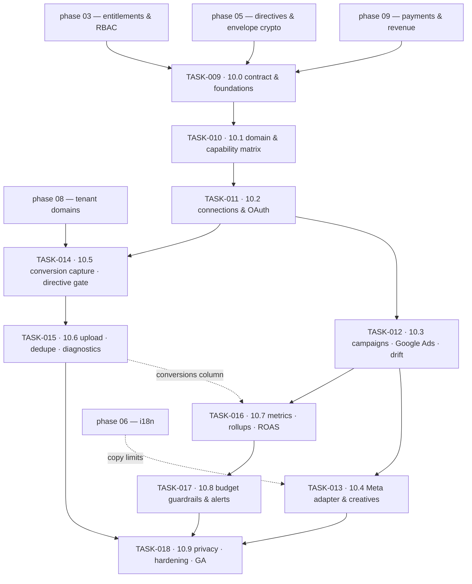

# Phase 10 — Advertising & Campaign Management · task order

**Target version:** 0.11.0 · **Theme:** growth · **Contexts:** `advertising` (new), `privacy`
(directives), `payments` (revenue), `domains` (first-party tracking), `platform-admin`
(entitlements), `localization`, `theming`, `notifications`, `audit`

Ten tasks, one per vertical slice. The *what* and *why* live in
[`../../phase-10-advertising/implementation-plan.md`](../../phase-10-advertising/implementation-plan.md);
this file is authoritative for **order**, slicing, and each slice's exit criteria. Status lives in
[`../backlog.md`](../backlog.md), and the per-task exit bar in
[`../definition-of-done.md`](../definition-of-done.md).

## The invariant that governs every task

**No identifier leaves Sanvi without a live directive that permits it.** Every outbound upload —
conversion, audience refresh, enhanced-match payload — asks the phase-05 `DirectiveResolver` first and
records the answer it got. A gate that can be bypassed "just for this batch" is not a gate: TASK-009
lands the CI gates that make a regression fail the build rather than fail an audit, and TASK-014 lands
the gate itself **before** TASK-015 lands anything that can upload. Stated formally as NFR-1001 and
NFR-1002 in [`../../requirements.md`](../../requirements.md).

Two standing rules follow it through every task:

- **Two numbers, never one.** Platform-reported conversion value and Sanvi-observed revenue are
  reported side by side, both labelled. Any screen, export, or API field that blends them is wrong
  (NFR-1006).
- **Our code spends the tenant's money.** Every mutation is idempotent, attributed in a change log, and
  bounded by a cap (NFR-1007).

## Tasks

| Task | Slice | Size | Scope | Ships behind |
|---|---|---|---|---|
| [TASK-009](TASK-009-10-0-contract-schema-foundations.md) | 10.0 | M | `advertising` crate, partitioned schema + RLS, token envelope, retention, config, CI gates | `advertising.enabled` (off) |
| [TASK-010](TASK-010-10-1-domain-model-capability-matrix-fake-adapter.md) | 10.1 | M | unified campaign model, `AdPlatformPort`, `CapabilityMatrix`, validation engine, fake adapter | `advertising.enabled` |
| [TASK-011](TASK-011-10-2-connections-oauth-token-lifecycle.md) | 10.2 | L | Google/Meta OAuth, signed state, encrypted tokens, refresh scheduler, revocation | `advertising.google_ads`, `advertising.meta` |
| [TASK-012](TASK-012-10-3-campaign-tree-google-ads-adapter-drift.md) | 10.3 | L | campaign CRUD, idempotent mutations, change log, publish, reconciliation & drift | `advertising.google_ads` |
| [TASK-013](TASK-013-10-4-meta-adapter-creatives.md) | 10.4 | L | Meta Marketing API adapter, creative model, per-platform specs | `advertising.meta` |
| [TASK-014](TASK-014-10-5-conversion-capture-the-directive-gate.md) | 10.5 | L | `/public/track`, site key, bot filter, click-id capture, directive resolution, hashing | `advertising.conversion_tracking` |
| [TASK-015](TASK-015-10-6-conversion-upload-dedupe-diagnostics.md) | 10.6 | M | upload workers, batching, retry, dedupe, audience sync, suppression, diagnostics | `advertising.conversion_tracking` |
| [TASK-016](TASK-016-10-7-metrics-ingestion-rollups-roas-query-layer.md) | 10.7 | L | restatement-aware ingestion, partitions, rollups, revenue join, ROAS query, export | `advertising.dashboard` |
| [TASK-017](TASK-017-10-8-budget-guardrails-spend-alerts.md) | 10.8 | M | per-campaign/per-tenant caps, thresholds, auto-pause, dry-run, audit trail | `advertising.budget_guardrails` |
| [TASK-018](TASK-018-10-9-privacy-integration-hardening-release.md) | 10.9 | M | `PersonalDataProvider`, sub-processor registry, retraction, metrics, alerts, runbooks | flags default on → tag `v0.11.0` |

Sizes are relative, not calendar estimates: **S** ≈ a couple of days for one pair, **M** ≈ under a
week, **L** ≈ a week or more with backend and frontend running concurrently.

## Dependency graph

Three edges are hard blockers rather than conveniences:

- **TASK-010 → TASK-011/TASK-012.** The capability matrix exists before either adapter does. Build
  Google first and Google's shape *becomes* the abstraction; Meta then arrives as a pile of special
  cases, and the "third network is an adapter, not a rewrite" acceptance criterion is already lost.
- **TASK-014 → TASK-015.** Nothing that can upload is built before the gate that decides whether it
  may. Reversed, the gate becomes a filter bolted onto a working pipeline — and a bolted-on privacy
  gate is the one that grows an emergency bypass flag six months later.
- **TASK-016 → TASK-017.** Auto-pause acts on a spend number. Before ingestion is restatement-aware,
  that number is provisional, and pausing a tenant's campaigns on provisional data costs their trust
  rather than their budget.

TASK-013 and TASK-014 are independent of each other and can run in parallel once TASK-012 is on
staging.

## Cross-track coordination

Each task's **Contract** checklist item lands first and is the handshake with `sanvi-frontend`, whose
`TASK-00N`/`TASK-01N` implements the same slice `10.(N-9)`. Backend leads every slice: the frontend
task of the same number carries a `**Blocked by (cross-repo):**` line naming its backend counterpart.
The one edge running the other way is TASK-018, which cannot tag `v0.11.0` until the frontend's
TASK-018 is also done.

TASK-010's **fake adapter and its capability matrices** are what make concurrency real — they let the
frontend build the 10.2–10.4 screens before Google developer-token approval and Meta app review land,
and they double as the proof that the platform abstraction holds. Treat them as a deliverable to the
other repo, not as test scaffolding. Chart primitives in the frontend's TASK-016 are likewise built
against fixtures and can start as soon as TASK-009 fixes the metric shapes.

**Start the Google Ads developer token application and the Meta app review at phase kickoff**, not at
TASK-011. Both are external approval queues measured in weeks; test-account access unblocks
development in the meantime, and a slice waiting on a form is the most avoidable delay in the phase.

## Traceability to the implementation plan

| Plan work-breakdown item | Lands in |
|---|---|
| 1. Domain model + `CapabilityMatrix` + validation engine | TASK-010 |
| 2. OAuth flows, signed state, token encryption, refresh, revocation | TASK-011 |
| 3. `AdPlatformPort` + Google Ads adapter | TASK-010 (port) · TASK-012 (adapter) · TASK-016 (metrics) · TASK-015 (upload) |
| 4. Meta adapter | TASK-013 (campaign tree) · TASK-016 (Insights) · TASK-015 (Conversions API) |
| 5. Tracking endpoint | TASK-014 |
| 6. Upload workers, batching, retry, dedupe, diagnostics, suppression | TASK-015 |
| 7. Metrics ingestion, backfill, partitioning, rollups | TASK-016 |
| 8. Revenue join with phase 09 + ROAS query layer | TASK-016 |
| 9. Budget guardrails, alerts, auto-pause, audit trail | TASK-017 |
| 10. Drift detection & reconciliation reporting | TASK-012 (engine, Google) · TASK-013 (Meta) |
| 11. `PersonalDataProvider` for the context | TASK-018 |
| 12. Runbooks | TASK-018 |

## Release plan

Each task tags a prerelease off the phase branch (`v0.11.0-alpha.N`) so staging always has a nameable
artifact. `v0.11.0` is tagged only at the end of TASK-018, when the phase acceptance criteria in both
parent plans are all checked and the flags are on by default.
