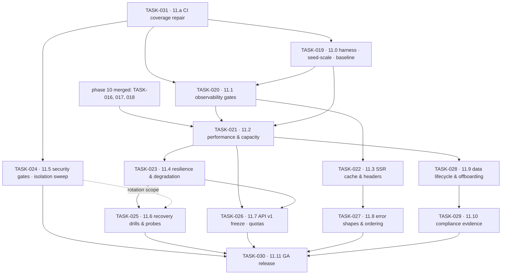

# Phase 11 — Hardening, Observability & GA · task order

**Target version:** 1.0.0 · **Theme:** ship it · **Contexts:** all thirteen, plus
`crates/platform/{telemetry,http,cache,persistence,messaging}` and `apps/{api,worker,cli}`

Thirteen tasks. The *what* and *why* live in
[`../../phase-11-hardening-ga/implementation-plan.md`](../../phase-11-hardening-ga/implementation-plan.md);
this file is authoritative for **order**, slicing, and each slice's exit criteria. Status lives in
[`../backlog.md`](../backlog.md), the per-task exit bar in
[`../definition-of-done.md`](../definition-of-done.md), and everything cut from the phase in
[`../../release/needs-humans.md`](../../release/needs-humans.md).

> **For agentic workers:** every task file in this directory is written as an executable plan.
> Use `superpowers:subagent-driven-development` (a fresh subagent per task, review between tasks) or
> `superpowers:executing-plans` (inline). Steps are `- [ ]` checkboxes with a verification command each.
> **Do not tick a step whose verification command has not been run.** A task whose steps are all ticked
> but whose `## Definition of done` still has an unchecked line is not done.

## The invariant that governs every task

**Nothing is claimed that has not been measured, and nothing is trusted that has not been rehearsed.**

Its operational form, which is what actually decides whether a criterion belongs in a task file:
**an acceptance criterion that cannot be falsified by running a command is not an acceptance
criterion.** Criteria that needed a vendor report, a second person's signature, or four weeks of
production traffic are in `needs-humans.md`, not here.

Two standing rules follow it:

- **Baseline first, tune second.** Every optimisation task opens by recording the current number and
  closes by recording the new one, in the same harness, against the same data. A regression against the
  stored run blocks the merge, not the release (NFR-1101).
- **No new features.** The single exception is TASK-026's quota and usage surface (NFR-1102).

## The phase splits in two

Backend phase 10 is still in flight: TASK-016 is uncommitted, TASK-017 and TASK-018 are open. Under the
original "depends on phases 00–10" edge, every phase 11 task was blocked and none could start.

The gate tasks do not need feature completeness, because they **enumerate** rather than audit: a check
that fails when a use case has no span does not care how many use cases exist, and it is worth more
early, because phase 10's remaining work then arrives already covered.

### Gate half — startable today

| Task | Slice | Size | Scope | Needs phase 10? |
|---|---|---|---|---|
| [TASK-031](TASK-031-11-a-ci-coverage-repair-and-gate-truth.md) | 11.a | S | six crates' integration tests never run in CI; SAST added; stale baseline claims corrected; Gatekeeper prerequisite detected | no |
| [TASK-019](TASK-019-11-0-production-shaped-baseline-measurement.md) | 11.0 | M | `seed-scale`, k6 harness, `benchmarks/`, `perf-compare`, `GET /system/build`, GA checklist | no |
| [TASK-020](TASK-020-11-1-observability-completion-slos-alerting.md) | 11.1 | L | span coverage matrix + gate, log PII scanner, `trace_id`, alert rules, runbook cross-reference | no |
| [TASK-024](TASK-024-11-5-threat-model-blocking-scanners-isolation-swee.md) | 11.5 | L | threat model, generated route/permission matrix + gate, RLS matrix incl. child partitions, IDOR sweep, abuse controls, security headers | no |

### GA half — needs phase 10 merged

| Task | Slice | Size | Scope | Ships behind |
|---|---|---|---|---|
| [TASK-021](TASK-021-11-2-backend-performance-load-testing-capacity-mod.md) | 11.2 | L | profiling, query & index review, pool sizing, cache review, N+1 removal, load/spike/soak | none — behaviour-preserving |
| [TASK-022](TASK-022-11-3-ssr-response-cache-cache-headers-compression.md) | 11.3 | M | keyed SSR cache with single-flight, cache headers per app, compression, LCP preload | `platform.ssr_cache` |
| [TASK-023](TASK-023-11-4-resilience-degradation-zero-downtime-deploys.md) | 11.4 | L | dependency matrix + injection test per row, degradation rules, backpressure, timeout gate, expand/contract | `platform.load_shedding`, `platform.degraded_mode` |
| [TASK-025](TASK-025-11-6-recovery-drills-secret-rotation-health-probes.md) | 11.6 | M | timed restore drill, PITR, single-tenant restore, rotation drill, `/health`, `/ready`, graceful shutdown | none |
| [TASK-026](TASK-026-11-7-api-v1-freeze-deprecation-policy-rate-limits.md) | 11.7 | M | consistency pass, freeze gate, `Deprecation`/`Sunset`, per-plan limits, quotas, replay suite | `platform.rate_limits`, `platform.quotas` |
| [TASK-027](TASK-027-11-8-error-addressability-collection-ordering-temp.md) | 11.8 | S | field-addressable errors, deterministic collection ordering, accessible templates | none |
| [TASK-028](TASK-028-11-9-data-lifecycle-at-scale-archival-tenant-offbo.md) | 11.9 | M | partitioning, archival + rehearsed restore, retention verification, offboarding export-then-purge | `platform.archival` |
| [TASK-029](TASK-029-11-10-compliance-evidence-packs-jurisdiction-drill.md) | 11.10 | M | generated evidence packs, provider completeness test, erasure propagation verification | none |
| [TASK-030](TASK-030-11-11-ga-release-gate-flag-cleanup-staged-rollout.md) | 11.11 | M | release gate re-run, benchmark re-run, flag cleanup, revert rehearsal, changelog | flags to GA defaults → tag `v1.0.0` |

Sizes are relative, not calendar estimates: **S** ≈ a couple of days, **M** ≈ under a week, **L** ≈ a
week or more.

## Dependency graph

Five edges are hard blockers rather than conveniences:

- **TASK-031 → the other three gate tasks.** A gate added to a CI job that does not run the code it
  gates is decoration. Fix what CI actually executes before adding to it.
- **TASK-019 → TASK-021.** Tuning without a stored baseline produces changes nobody can defend, and
  worse, regressions nobody can detect: the second optimisation undoes the first and the graph still
  looks fine because no one kept the first graph.
- **TASK-020 → TASK-021 and TASK-022.** You tune what you can see. Profiling before trace coverage is
  complete means the slow dependency is the one with no span, and it stays slow because it stays
  invisible.
- **TASK-021 → TASK-023 and TASK-026.** Load-shedding thresholds and per-plan rate limits are both
  numbers derived from measured capacity. Set them by guess and they are either decorative (too high)
  or an outage of our own making (too low).
- **TASK-022 → TASK-027.** Error shapes and collection ordering interact with cached SSR responses;
  changing them after the cache lands invalidates a warm cache for a cosmetic reason.

## Parallelism

After TASK-031 the gate tasks are independent of each other and of phase 10. In the GA half:

| Track | Tasks |
|---|---|
| Speed | TASK-021, TASK-022, TASK-028 |
| Trust | TASK-023, TASK-025 |
| Contract & evidence | TASK-026, TASK-027, TASK-029 |

## Cross-track coordination

`sanvi-frontend` runs a task of the same number for the same slice. **The frontend is two phases
behind**: its phase 09 is 3/8 done and its phase 10 has not started, so frontend phase 11 is
unreachable until those land. Backend gate tasks do not wait on it. Backend TASK-030 does — it cannot
tag `v1.0.0` until frontend TASK-030 is done, and that is the one cross-repo edge running
frontend-to-backend.

Two backend deliverables unblock frontend work earlier than the slice order suggests, and should be
treated as deliverables to the other repo rather than as internal tooling: `GET /api/v1/system/build`
from TASK-019 (release stamping) and the `traceparent` / `trace_id` convention from TASK-020 (the trace
id on every error screen).

## Traceability to the implementation plan

| Plan work-breakdown item | Lands in |
|---|---|
| 1. CI coverage repair | TASK-031 |
| 2. Measurement harness and production-shaped data | TASK-019 |
| 3. Observability gates | TASK-020 · runbooks extended in TASK-023, TASK-025 |
| 4. Safety gates | TASK-024 |
| 5. Performance | TASK-021 · index and vacuum work in TASK-028 |
| 6. SSR response cache | TASK-022 |
| 7. Resilience | TASK-023 |
| 8. Recovery | TASK-025 |
| 9. API stabilisation | TASK-026 |
| 10. Error shapes and ordering | TASK-027 |
| 11. Data lifecycle | TASK-028 |
| 12. Compliance evidence | TASK-029 |
| 13. GA release | TASK-030 |

## Release plan

Each GA-half task tags a release candidate off the phase branch so a drill can name the exact build it
ran against. Gate-half tasks merge to the working branch without an rc tag; they change CI and
platform crates, not product behaviour. `v1.0.0` is tagged at the end of TASK-030, when the GA
checklist has no open line and both repositories' TASK-030 are done.
