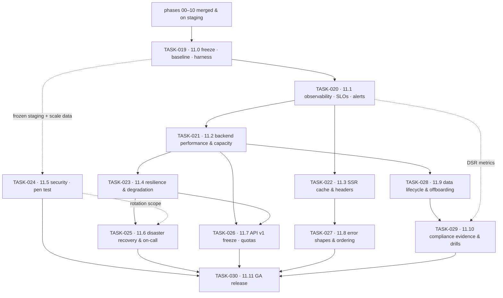

# Phase 11 — Hardening, Observability & GA · task order

**Target version:** 1.0.0 · **Theme:** ship it · **Contexts:** all thirteen, plus
`crates/platform/{telemetry,http,cache,persistence,messaging}` and `apps/{api,worker,cli}`

Twelve tasks, one per vertical slice. Unlike phases 09 and 10, each slice ends with a number, a report,
or a rehearsed drill rather than a feature. The *what* and *why* live in
[`../../phase-11-hardening-ga/implementation-plan.md`](../../phase-11-hardening-ga/implementation-plan.md);
this file is authoritative for **order**, slicing, and each slice's exit criteria. Status lives in
[`../backlog.md`](../backlog.md), and the per-task exit bar in
[`../definition-of-done.md`](../definition-of-done.md).

## The invariant that governs every task

**Nothing is claimed that has not been measured, and nothing is trusted that has not been rehearsed.**
A backup that has never been restored is a hypothesis; an SLO with no burn-rate alert is a wish; a
"faster" endpoint with no before-number is a feeling. TASK-019 exists solely so that every later task
has a baseline to be judged against, which is why it is first and why it ships no behaviour at all.
Stated formally as NFR-1101.

Three standing rules follow it through every task:

- **Baseline first, tune second.** Every optimisation task opens by recording the current number and
  closes by recording the new one, in the same harness, against the same production-shaped data. A
  regression against the stored run blocks the merge, not the release (NFR-1101).
- **No new features.** Phase 11 adds no user-facing capability. The single exception is TASK-026's quota
  and rate-limit surfaces — because a limit users cannot see is a bug report waiting to happen
  (NFR-1102).
- **Time-boxed by the acceptance list.** Hardening is an infinite well. `docs/release/ga-checklist.md`
  and the implementation plan's acceptance criteria are the exit condition; anything discovered beyond
  them gets an owner, a ticket, and a post-GA date — it does not extend the phase.

## Tasks

| Task | Slice | Size | Scope | Ships behind |
|---|---|---|---|---|
| [TASK-019](TASK-019-11-0-freeze-production-shaped-baseline-measurement.md) | 11.0 | M | release branch policy, `seed-scale`, k6 harness, benchmark history, staging parity, GA checklist, external bookings | none — tooling only |
| [TASK-020](TASK-020-11-1-observability-completion-slos-alerting.md) | 11.1 | L | span/log audit, PII log scanner, dashboards per context & journey, SLOs, burn-rate alerts, runbook set | `platform.tail_sampling` |
| [TASK-021](TASK-021-11-2-backend-performance-load-testing-capacity-mod.md) | 11.2 | L | profiling, query & index review, pool sizing, cache review, N+1 removal, load/spike/soak, capacity model | none — behaviour-preserving |
| [TASK-022](TASK-022-11-3-ssr-response-cache-cache-headers-compression.md) | 11.3 | M | keyed SSR cache with single-flight, cache headers per app, Brotli, LCP preload | `platform.ssr_cache` |
| [TASK-023](TASK-023-11-4-resilience-degradation-zero-downtime-deploys.md) | 11.4 | L | dependency matrix, degradation rules, backpressure & shedding, chaos drills, expand/contract deploys | `platform.load_shedding`, `platform.degraded_mode` |
| [TASK-024](TASK-024-11-5-threat-model-blocking-scanners-isolation-swee.md) | 11.5 | L | STRIDE refresh, blocking CI scanners, route/permission matrix, RLS + IDOR sweep, abuse controls, SBOM | none — findings-driven |
| [TASK-025](TASK-025-11-6-disaster-recovery-secret-rotation-on-call-rea.md) | 11.6 | M | WAL + base backups, timed restore, PITR, single-tenant restore, rotation drill, health/ready, on-call | `platform.status_probes` |
| [TASK-026](TASK-026-11-7-api-v1-freeze-deprecation-policy-rate-limits.md) | 11.7 | M | spec-wide consistency pass, freeze gate, `Deprecation`/`Sunset`, per-plan limits, quotas, replay suite | `platform.rate_limits`, `platform.quotas` |
| [TASK-027](TASK-027-11-8-error-addressability-collection-ordering-temp.md) | 11.8 | S | field-addressable errors, deterministic collection ordering, accessible email templates | none |
| [TASK-028](TASK-028-11-9-data-lifecycle-at-scale-archival-tenant-offbo.md) | 11.9 | M | partitioning, archival + restore path, retention verification, vacuum & bloat, offboarding export-then-purge | `platform.archival` |
| [TASK-029](TASK-029-11-10-compliance-evidence-packs-jurisdiction-drill.md) | 11.10 | M | generated Art. 30 / risk / sub-processor / retention evidence, DSR live-fire, breach tabletop, notice diff | none — evidence slice |
| [TASK-030](TASK-030-11-11-ga-release-gate-flag-cleanup-staged-rollout.md) | 11.11 | M | release gate re-run, benchmark re-run, flag cleanup, rollback rehearsal, staged rollout, changelog | flags to GA defaults → tag `v1.0.0` |

Sizes are relative, not calendar estimates: **S** ≈ a couple of days for one pair, **M** ≈ under a
week, **L** ≈ a week or more with backend and frontend running concurrently.

## Dependency graph

Four edges are hard blockers rather than conveniences:

- **TASK-019 → everything.** Tuning without a stored baseline produces changes nobody can defend. Worse,
  it produces *regressions* nobody can detect: the second optimisation undoes the first and the graph
  still looks fine because no one kept the first graph.
- **TASK-020 → TASK-021/TASK-022.** You tune what you can see. Profiling before trace coverage is
  complete means the slow dependency is the one with no span, and it stays slow because it stays
  invisible.
- **TASK-021 → TASK-023 and TASK-021 → TASK-026.** Load-shedding thresholds and per-plan rate limits are
  both numbers derived from measured capacity. Set them by guess and they are either decorative (too
  high) or an outage of our own making (too low).
- **TASK-022 → TASK-027.** Error shapes and collection ordering interact with cached SSR responses;
  changing them after the cache lands means invalidating a warm cache for a cosmetic reason.

TASK-024 runs on its own track against the frozen staging build and only needs TASK-019, so it can
proceed while TASK-021–TASK-023 are in flight. TASK-027, TASK-028, and TASK-029 are likewise independent
of each other beyond the edges drawn above.

## Parallelism

Phase 11 splits cleanly into three tracks that run concurrently after TASK-020:

| Track | Tasks | Owner shape |
|---|---|---|
| Speed | TASK-021, TASK-022, TASK-028 | backend perf + frontend perf pairs |
| Trust | TASK-023, TASK-024, TASK-025 | platform/infra + security |
| Contract & evidence | TASK-026, TASK-027, TASK-029 | API owner, a11y owner, privacy owner |

**Book both external engagements in TASK-019** — the third-party penetration test (TASK-024) and the
external accessibility audit (frontend TASK-027). Both are approval-and-scheduling queues measured in
weeks, both need a feature-frozen staging environment with production-shaped data to be worth anything,
and both produce findings that need a remediation window before GA. A phase that waits until the
relevant task to book them ships late for reasons that have nothing to do with engineering.

Unlike phases 09 and 10, most tasks here are **not** contract-first: they change how the system behaves
under stress, not what it exposes. The exceptions are TASK-026 (which rewrites parts of every spec),
TASK-025 (health/readiness surfaces), TASK-022 (cache semantics), and TASK-028 (offboarding endpoints) —
all four keep the contract-first handshake.

## Cross-track coordination

`sanvi-frontend` runs a task of the same number for the same slice, so TASK-0NN here pairs with TASK-0NN
there. Backend leads every slice except two:

- **TASK-021** owns no frontend work at all; frontend TASK-021 is the harness re-run and the
  client-call-pattern audit that this task's profiling produces as a side effect.
- **TASK-030** is the one edge running frontend-to-backend: `v1.0.0` cannot be tagged until the
  frontend's TASK-030 is also done.

Two backend deliverables unblock frontend work earlier than the slice order suggests and should be
treated as deliverables to the other repo rather than as internal tooling: `GET /api/v1/system/build`
from TASK-019 (release stamping for RUM and the error tracker) and the `traceparent`/`trace_id`
convention from TASK-020 (the trace id on every error screen).

## Traceability to the implementation plan

| Plan work-breakdown item | Lands in |
|---|---|
| 1. Observability completion (traces, logs, dashboards, alerts, runbooks) | TASK-020 · runbooks extended in TASK-023, TASK-025 |
| 2. Performance (profiling, queries, pools, cache, N+1, load/soak, capacity) | TASK-021 · SSR cache in TASK-022 · index/vacuum in TASK-028 |
| 3. Resilience (dependency matrix, degradation, backpressure, chaos, zero-downtime) | TASK-023 |
| 4. Disaster recovery (backups, RPO/RTO, PITR, rotation drill, status page) | TASK-025 |
| 5. Security (threat model, pen test, CI scanning, authz review, isolation, abuse, supply chain) | TASK-024 |
| 6. API stabilisation (`v1` freeze, deprecation policy, limits, docs, replay suite) | TASK-026 |
| 7. Data lifecycle (partitioning, archival, retention verification, vacuum, offboarding) | TASK-028 |
| 8. Compliance readiness (evidence packs, DSR drills, breach tabletop, notice review) | TASK-029 |

The plan has no work-breakdown item for TASK-027 or TASK-030: the first is the API-side half of the
frontend's accessibility work, and the second is the release itself.

## Release plan

Each task tags a release candidate off the phase branch (`v1.0.0-rc.N`, N = slice index + 1) so staging
always has a nameable artifact and the pen test, the a11y audit, and every drill can name the exact
build they ran against. `v1.0.0` is tagged only at the end of TASK-030, when both parent plans'
acceptance criteria are checked, both external reports are remediated, and the GA checklist from
TASK-019 has no unowned line.
